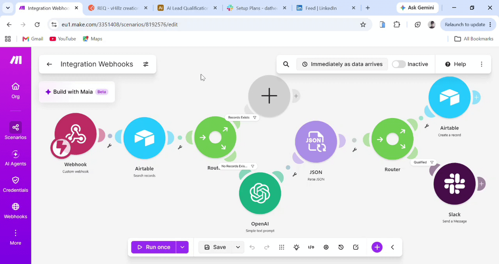

## Project 1: Multi-Source Lead Routing & Instant AI Qualification

    Key System Architecture & Workflow Mechanics
The solution is orchestrated using **Make.com** and seamlessly connects **Webhooks, Airtable, OpenAI,** and **Slack** through a structured multi-branch scenario:   

1. **Trigger — Custom Webhook:**
    - Instantly ingests raw lead submission data from forms or external web sources as soon as data arrives.
2. **Database Lookup — Airtable (Search records):** 
    - Queries Airtable to check if the incoming lead already exists in the CRM.
3. **Conditional Routing — Router:**
    - If Records Exist: Routes directly down the top path. 
    - If No Record Exists: Routes down the bottom path to trigger AI qualification.   
4. **AI Qualification & Parsing — OpenAI + JSON Parser:**
    - OpenAI (Simple text prompt): Analyzes lead attributes (company size, budget, requirements) to compute a qualification score and generate custom sales talking points.   
5. **Database Update & Execution — Airtable + Slack:**
    - Airtable (Create a record): Automatically saves the newly qualified lead details into the database.   
    - Slack (Send a Message): Sends an instant, detailed alert to the sales team on Slack containing the qualified lead information and tailored talking points.  