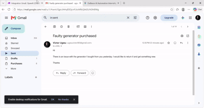

## PROJECT 2: Autonomous Customer Support & Intelligent Email Triage
As an AI Automation Intern, I built an Autonomous Customer Support & Intelligent Email Triage System using Make.com, OpenAI, and Gmail to streamline customer communications.   

## 📩 How it works:

**1️⃣ Watch Inbox:** Monitors incoming customer emails automatically.   

**2️⃣ AI Analysis:** Uses OpenAI to evaluate email sentiment, extract intent, and separate urgent technical issues from billing queries.  

**3️⃣ JSON Parsing:** Converts AI decisions into structured data for precise execution. 

**4️⃣ Automated Response:** Drafts and sends personalized, context-aware replies back to the customer instantly. By taking human intervention out of initial email routing, this pipeline significantly reduces response time and frees up team members to tackle higher-priority challenges!   