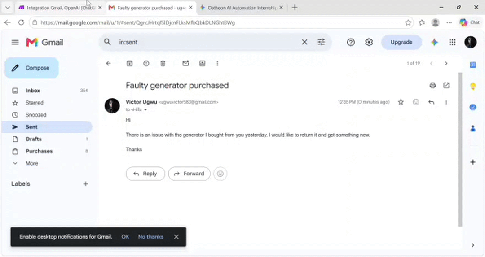

## PROJECT 2: Autonomous Customer Support & Intelligent Email Triage

    Key System Architecture & Workflow Mechanics
The system is built on **Make.com** and integrates **Gmail** with **OpenAI** (ChatGPT/Whisper) models using a 4-step pipeline:   

1. **Trigger — Gmail (Watch emails):**
    - Monitors the inbox every 15 minutes for new incoming support emails.   
2. **AI Triage — OpenAI (Simple text prompt):**
    - Processes the raw text content of the email to analyze sentiment, categorize intent (e.g., distinguishing urgent support tickets vs. routine billing queries), and perform knowledge retrieval to generate an appropriate response.   
3. **Data Structuring — JSON (Parse JSON):**
    - Formats and structures the unstructured output from OpenAI into standardized JSON parameters (such as response body, ticket priority/tags, and recipient address) for downstream execution.   
4. **Execution — Gmail (Reply to an email):**
    - Automatically crafts and dispatches polite, context-aware email replies directly back to the sender.   