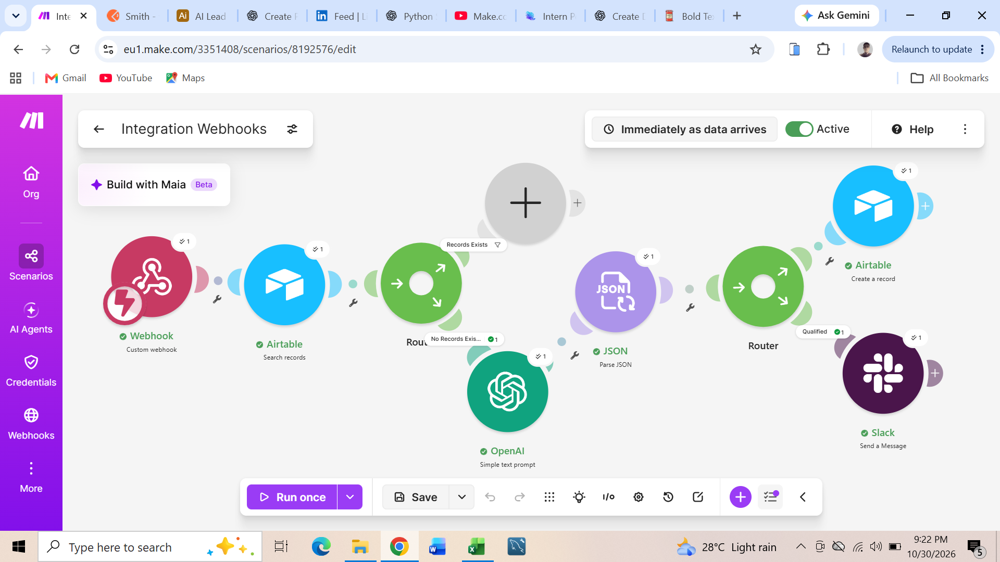

## Project 1: Multi-Source Lead Routing & Instant AI Qualification
*Overview*  
During my AI Automation internship at Datheon, I engineered an automated end-to-end lead qualification system designed to ingest, evaluate, and route inbound leads in real time. The primary objective of this workflow is to capture form entries via webhooks, evaluate lead quality (such as company size and budget) instantly using OpenAI, record structured data in Airtable, and notify sales teams on Slack with actionable talking points.   

## Tech Stack & Tools Used
- **Orchestration:** Make.com   
- **Data Capture:** Custom Webhooks   
- **Database / CRM:** Airtable   
- **AI & NLP Engine:** OpenAI (ChatGPT)   
- **Data Transformation:** JSON Parser   
- **Team Communication:** Slack 

## Impact & Performance Metrics
- **Sub-10-Second Execution:** The entire end-to-end process—from initial form submission to final Slack notification—executes in under 10 seconds.   
- **Instant Lead Qualification:** Completely removes manual lead triage by automating company size and budget evaluations. 
- **Sales Empowerment:** Delivers custom AI-generated talking points directly to Slack, allowing sales representatives to follow up instantly with personalized context.   

## Project 2 : Autonomous Customer Support & Intelligent Email Triage
*Overview*  
During my AI Automation internship at Datheon, I built an automated end-to-end workflow designed to handle customer support inquiries via email autonomously. The goal of this system is to evaluate inbound customer emails, classify their intent/sentiment, parse key information, and automatically generate and send context-aware replies.

## Tech Stack & Tools Used
- **Orchestration:** Make.com   
- **AI & NLP engine:** OpenAI (ChatGPT / Whisper models)   
- **Email Client:** Gmail Integration   Data Transformation: Native JSON Parser   
## Impact & Results
- **Zero-Touch Triage:** Eliminates manual reading and routing of incoming support emails.
- **Faster Response Times:** Automated monitoring and execution cycle reduces first-response latency down to minutes. 
- **Scalable Support Operations:** Allows customer support teams to focus on edge cases while routine inquiries and tagging are handled fully autonomously. 