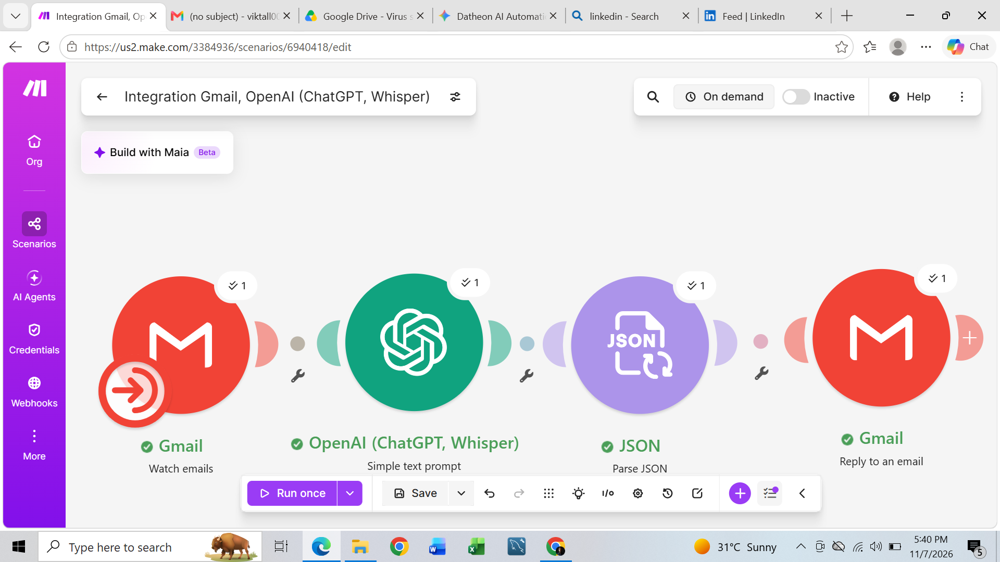

## Project 2 : Autonomous Customer Support & Intelligent Email Triage
*Overview*  
During my AI Automation internship at Datheon, I built an automated end-to-end workflow designed to handle customer support inquiries via email autonomously. The goal of this system is to evaluate inbound customer emails, classify their intent/sentiment, parse key information, and automatically generate and send context-aware replies.

## Tech Stack & Tools Used
- **Orchestration:** Make.com   
- **AI & NLP engine:** OpenAI (ChatGPT / Whisper models)   
- **Email Client:** Gmail Integration   Data Transformation: Native JSON Parser   
## Impact & Results
- **Zero-Touch Triage:** Eliminates manual reading and routing of incoming support emails.
- **Faster Response Times:** Automated monitoring and execution cycle reduces first-response latency down to minutes. 
- **Scalable Support Operations:** Allows customer support teams to focus on edge cases while routine inquiries and tagging are handled fully autonomously. 